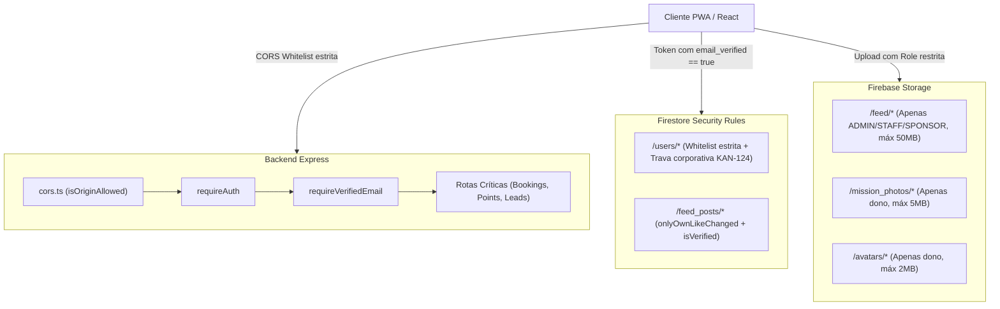

# HandOff de Engenharia: Auditoria e Endurecimento de Segurança (KAN-116)

**Documento para alinhamento entre engenheiros, agentes e auditoria de segurança**  
**Data:** 12/10/2026  
**Épico / Tarefa Jira:** KAN-116 (Auditoria e Blindagem de Segurança — E-mail, Regras e Endpoints)  
**Branch de Referência:** `feature/KAN-116-confirmacao-email-firebase`  
**Último Commit de Sincronização:** `20c23ea` (`[FIX] - sincroniza develop e resolve conflitos em index, rules e testes`)  
**Base Sincronizada:** `origin/develop` (inclui KAN-124 / Patrocinadores)  
**Status do Quality Gate:** **Score 1.0 (Aprovado)** (415 testes frontend/integração + 248 testes backend + 92 testes de regras em emulador)  
**Status de Segurança:** **Score 1.0 (Blindado)** — Fechamento integral de brechas em Auth, Firestore, Storage e Express Backend.

---

## 1. Visão Geral e Motivação

Durante a revisão de segurança e arquitetura do app da FACOM TechWeek 2026, foram identificados pontos de vulnerabilidade crítica decorrentes da transição do Supabase para o Firebase:
1. **Storage permissivo**: Qualquer participante autenticado podia subir vídeos de até 250MB no Feed, gerando risco de DoS, armazenamento indevido e estouro de custos na Google Cloud.
2. **Bypass de regras via Backend Admin SDK**: As regras do Firestore exigiam `email_verified == true`, mas as rotas do backend Express utilizavam privilégios de superusuário sem validar a flag de e-mail no token JWT.
3. **CORS wildcard (`origin: true`)**: Qualquer origem externa podia disparar requisições autenticadas para o backend.
4. **Troca e deleção insegura de conta**: Troca de e-mail imediata sem validação prévia (`updateEmail`) e deleção de dados no Firestore antes de confirmar exclusão no Firebase Auth.
5. **Atrito de UX na verificação**: Participantes precisavam descobrir manualmente que deviam clicar em "Já confirmei meu e-mail" após abrir o link de confirmação em outra aba/aplicativo.

Todas as frentes foram remediadas seguindo metodologia TDD rigorosa (Red -> Green -> Validação) e integradas harmonicamente com as alterações recentes da branch `develop` (KAN-124).

---

## 2. Mapa das Atualizações de Segurança



---

## 3. Detalhamento Técnico das Correções

### A. Endurecimento do Firebase Storage (`storage.rules`)
- **Feed (`/feed/{mediaType}/{fileName}`)**:
  - **Antes**: Escrita permitida para qualquer usuário autenticado (`request.auth != null`) de arquivos de até 250MB.
  - **Agora**: Restrito exclusivamente a `ADMIN`, `STAFF` ou `SPONSOR` (`request.auth.token.role in ['ADMIN', 'STAFF', 'SPONSOR'] || request.auth.token.admin == true`).
  - **Limites e Tipos**:
    - Vídeos: Máximo 50MB (`video/mp4`, `video/webm`, `video/quicktime`).
    - Imagens: Máximo 10MB (`image/jpeg`, `image/png`, `image/webp`).
    - Proibição absoluta de SVG e tipos executáveis.
- **Missões (`/mission_photos/{userId}/{fileName}`)**:
  - Restrito ao próprio dono autenticado (`request.auth.uid == userId`).
  - Limite rigoroso de cota: 5MB (anteriormente 10MB).
  - Tipos mime permitidos: `image/(jpeg|png|webp)`.
- **Avatares (`/avatars/{userId}/{fileName}`)**:
  - Restrito ao próprio dono autenticado (`request.auth.uid == userId`).
  - Limite de 2MB e tipos de imagem seguros.
- **Default Deny**: Qualquer outro caminho no bucket tem leitura e escrita bloqueadas (`allow read, write: if false;`).
- **Testes**: 15 cenários automatizados cobrindo permissões e rejeições em `tests/rules/storage.test.js`.

---

### B. Restrição Estrita de CORS no Backend Express (`backend/src/config/cors.ts`)
- Substituição do `app.use(cors({ origin: true }))` por política com whitelist estrita.
- **Regras**:
  - Permite requisições sem header `Origin` (chamadas server-to-server, health checks, curl/Postman).
  - Em desenvolvimento/teste (`NODE_ENV !== 'production'`), permite `localhost` e `127.0.0.1`.
  - Em produção, valida contra a variável de ambiente `CORS_ALLOWED_ORIGINS` (lista separada por vírgulas) com fallback seguro para os domínios oficiais da TechWeek, Firebase Hosting e Vercel.
  - Rejeita qualquer origem não autorizada com `Error('Origin not allowed by CORS policy.')`.

---

### C. Middleware `requireVerifiedEmail` no Backend Express
- Localização: `backend/src/middlewares/authMiddleware.ts`.
- **Comportamento**:
  - Extrai a claim `emailVerified` do token JWT autenticado via `requireAuth`.
  - Se `emailVerified !== true` (e o usuário não for `ADMIN`), interrompe imediatamente o pipeline com HTTP 403:
    ```json
    {
      "error": "EMAIL_NOT_VERIFIED",
      "message": "É necessário confirmar seu e-mail antes de realizar esta ação."
    }
    ```
- **Rotas Blindadas**:
  - `POST /api/activities/book` e `POST /api/activities/cancel-booking` (reserva de vagas em palestras).
  - `POST /api/points/claim` (resgate de pontos de missões no backend).
  - `POST /api/leads` (credenciamento e captura de leads por patrocinadores).

---

### D. Troca Segura de E-mail e Ciclo de Vida de `pendingEmailChange`
- **Problema anterior**: `src/lib/userService.js` usava `updateEmail`, alterando a credencial sem exigir verificação prévia no novo e-mail.
- **Nova Arquitetura**:
  - Utiliza `verifyBeforeUpdateEmail(auth.currentUser, newEmail)`. A alteração só é concretizada no Firebase Auth após o clique de confirmação no link enviado para a nova caixa de entrada.
  - Grava no documento `/users/{uid}` o estado transitório:
    ```json
    {
      "pendingEmailChange": {
        "newEmail": "novo@exemplo.com",
        "requestedAt": 1728770000000,
        "expiresAt": 1728856400000
      }
    }
    ```
  - **Sincronização Idempotente**: Ao efetuar login ou recarregar a sessão (`reloadUser`), se `auth.currentUser.email` coincidir com `newEmail`, o documento do Firestore sincroniza `email` e remove atomicamente `pendingEmailChange`.
  - **Cancelamento**: Usuário pode descartar a troca pendente chamando `cancelPendingEmailChange(uid)`.
  - **Firestore Rules**: Adicionada validação estrutural `isValidPendingEmailChange()` e inclusão do campo na whitelist `userAllowedUpdateKeys()`.

---

### E. Ordem Segura e Reautenticação Prévia na Deleção de Conta
- Localização: `src/lib/auth.js` (`deleteCurrentUserAccount`).
- **Problema anterior**: O documento do Firestore era apagado antes do usuário no Firebase Auth. Se o Auth falhasse com `auth/requires-recent-login`, o usuário ficava órfão e com perfil destruído.
- **Fluxo Corrigido**:
  1. Se `currentPassword` for informada e o usuário tiver provedor de senha, executa reautenticação prévia via `reauthenticateWithCredential(user, EmailAuthProvider.credential(user.email, currentPassword))`.
  2. Executa a exclusão primeiro no Firebase Auth: `await deleteUser(user)`.
  3. Somente após a confirmação do Auth, remove o documento no Firestore: `await deleteDoc(doc(db, 'users', uid))`.
  4. Limpa caches e storage locais com `clearAuthLocalCaches()`.

---

### F. Refinamento de UX: Gate de Verificação de E-mail (`src/components/EmailVerificationGate.jsx`)
- Adicionados listeners de eventos de janela: `document.addEventListener('visibilitychange')` e `window.addEventListener('focus')`.
- Ao retornar para a aba do navegador, o componente invoca `reloadUser()` em segundo plano com controle de concorrência.
- Se o e-mail estiver confirmado, exibe feedback visual imediato e redireciona automaticamente sem exigir clique manual.
- Implementado polling inteligente com taxa moderada (4s) e proteção contra spam no reenvio de e-mail (cooldown de 60s persistido no `localStorage`).

---

### G. Sincronização e Resolução com o Módulo de Patrocinadores (KAN-124)
- **Conciliação de Regras `/users/{userId}`**:
  - Preservada a whitelist estrita do KAN-60 com exigência de `termsAcceptedAt == request.time` no create.
  - Incorporadas as travas anti-tampering corporativo do KAN-124: bloqueio de escrita direta de campos empresariais pelo cliente (`sponsorId`, `companyId`, `company`, `empresa`, `companyName`, `sponsorTermsVersion`, `jobTitle`).
  - Bloqueio de auto-deleção para contas vinculadas a patrocinador: `allow delete: if isOwner(userId) && !('sponsorId' in resource.data);`.
- **Feed e Likes (`/feed_posts/{postId}`)**:
  - Integrada a função canônica de likes `onlyOwnLikeChanged()`.
  - Exigida a verificação de e-mail para curtir/descurtir: `allow update: if isStaffOrAdmin() || (isVerified() && onlyOwnLikeChanged());`.
  - Suporte retrocompatível a `authorUid` e `authorId` para exclusão e autoria legítima.

---

## 4. Tabela de Matriz de Segurança e Cobertura de Testes

| Componente | Vulnerabilidade Prevenida | Arquivo Principal | Arquivo de Teste | Status |
|---|---|---|---|---|
| **Storage Feed** | DoS e upload arbitrário de vídeos pesados por participantes | `storage.rules` | `tests/rules/storage.test.js` | PASS (15 testes) |
| **Storage Missões** | Upload acima da cota de 5MB ou tipos não permitidos | `storage.rules` | `tests/rules/storage.test.js` | PASS |
| **CORS Backend** | Requisições maliciosas entre origens de terceiros | `backend/src/config/cors.ts` | `backend/src/config/cors.test.ts` | PASS (10 testes) |
| **Auth Middleware** | Bypass de regras do Firestore via Admin SDK por contas não verificadas | `backend/src/middlewares/authMiddleware.ts` | `backend/src/middlewares/authMiddleware.test.ts` | PASS (6 testes) |
| **Troca de E-mail** | Sequestro ou perda de conta por erro de digitação | `src/lib/userService.js` | `src/lib/userService.test.js` | PASS (13 testes) |
| **Deleção de Conta** | Estado órfão no Auth e perda de dados sem reautenticação | `src/lib/auth.js` | `tests/unit/deleteAccountSecurity.test.js` | PASS (4 testes) |
| **UX Verificação** | Abandono de onboarding por atrito na confirmação de e-mail | `src/components/EmailVerificationGate.jsx` | `tests/unit/emailVerificationGate.test.js` | PASS (1 teste) |
| **Firestore Users** | Elevação de privilégios e vínculo indevido com patrocinadores | `firestore.rules` | `tests/rules/users.test.js` + `backend/src/firestoreRules.test.ts` | PASS (47 testes) |
| **Firestore Feed** | Adulteração de conteúdo de posts e forja de likes alheios | `firestore.rules` | `tests/rules/feed_posts.test.js` | PASS (21 testes) |

---

## 5. Como Executar as Validações Localmente

1. **Testes Estáticos de Regras (sem emulador)**:
   ```bash
   npm --prefix backend test -- firestoreRules.test.ts
   ```
2. **Testes de Regras no Emulador Firebase (Firestore + Storage)**:
   ```bash
   npx vitest run tests/rules/
   ```
3. **Suíte Completa do Backend**:
   ```bash
   npm --prefix backend test
   ```
4. **Suíte Completa do Frontend e Integração**:
   ```bash
   npm test
   ```
5. **Quality Gate Integral**:
   ```bash
   npm run quality-gate
   ```
